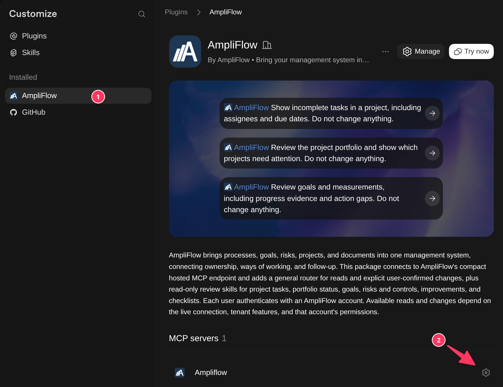
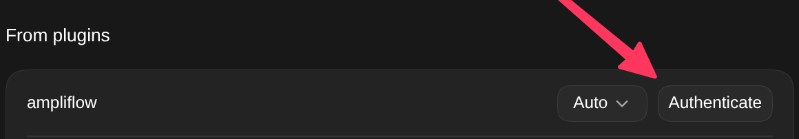

# AmpliFlow for ChatGPT

Use AmpliFlow in ChatGPT Desktop **Work** mode to review project tasks, portfolios, goals, risks and controls, improvements, and checklists. The general AmpliFlow skill can also answer other questions about your records and make changes you explicitly confirm.

This GitHub marketplace does not make AmpliFlow tools available in Desktop **Chat** mode, on the web, or on mobile.

## Import the marketplace

A ChatGPT workspace admin can add AmpliFlow:

1. Open **Admin > Plugins > Add > Import marketplace**.
2. Enter `https://github.com/AmpliFlow/af-chatgpt` as the source and leave **Path** empty.
3. Import the marketplace and make **AmpliFlow** available to users. Enable **AmpliFlow (Beta Channel)** only for users who want beta.

To update an existing marketplace, select **Sync now** on its GitHub source. See OpenAI's [marketplace import guide](https://help.openai.com/en/articles/20001504-importing-and-syncing-plugin-marketplaces-from-github).

## Connect and try it

1. Install **AmpliFlow** from the Plugins Directory and sign in to your AmpliFlow account when prompted.
2. Start a new ChatGPT Desktop conversation in **Work** mode.
3. Add `@AmpliFlow` and ask: "What projects do I have?"

For a focused review, try: "Show incomplete tasks in [project name], including assignees and due dates. Do not change anything."

AmpliFlow uses the permissions of your connected account. The six focused reviews are read-only. For a change, review the exact record and proposed values before confirming. ChatGPT receives the AmpliFlow data needed to answer your request, so use the integration only with records your organization allows you to share with ChatGPT.

## Troubleshooting

### AmpliFlow can't access its tools

If ChatGPT says it can't access AmpliFlow or load the instructions for a task such as creating an improvement, try these checks in order:

1. In ChatGPT Desktop, start a new **Work** conversation. Add `@AmpliFlow` and ask "What projects do I have?" This checks the connection without changing records. The mention can also appear in **Chat** mode, where the imported tools aren't available.
2. If the read fails, open **Plugins**, select your installed AmpliFlow plugin, and click the gear next to **AmpliFlow** under **MCP servers**.

   

3. Under **From plugins**, select **Authenticate** next to `ampliflow` if the button is shown. Then try the project read again in a new **Work** conversation.

   

4. If the plugin is missing or still unavailable, check which entry is installed. Use **AmpliFlow** for production or **AmpliFlow (Beta Channel)** for beta. If an older entry points to the wrong URL, ask your workspace admin to sync the marketplace, then reinstall only the affected entry and sign in again. Authorization is specific to the connection URL.

If the project read works but the improvement still can't be created, contact support with the plugin name and version, the error text, and a redacted example prompt. If a create request may already have been sent, check AmpliFlow for the record before trying again.

| Plugin | Connection URL |
| --- | --- |
| AmpliFlow | `https://mcp.ampliflow.com/mcp` |
| AmpliFlow (Beta Channel) | `https://mcp.ampliflow.cc/mcp-beta` |

For help with your AmpliFlow account or connection, contact [AmpliFlow support](https://www.ampliflow.com/support/).

## Maintainer build

`plugins/ampliflow/skills/` is the vendored ChatGPT projection from the shared skills producer. Make guidance changes in the producer. Update the projection, `plugins/ampliflow/skills.manifest.json`, and the reviewed digest in `scripts/check.py` together. Regenerate beta with `python3 -B scripts/sync_beta.py`, then run `python3 -B scripts/build_submission.py` to validate and build both packages locally. The bundled skill bytes are available without a network fetch.

## License

Copyright (c) 2026 Cognit Consulting AB, trading as AmpliFlow. All rights reserved. See [LICENSE](LICENSE).
